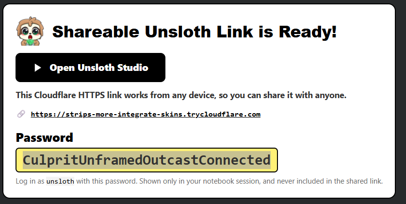

# Hướng Dẫn Chạy Google Colab & Đo Lường Thực Nghiệm (Dành Cho Thành Viên Nhóm)

Tài liệu này hướng dẫn chi tiết từng bước để các thành viên trong nhóm khởi động máy ảo GPU Google Colab (Unsloth Studio), lấy API URL và chạy lệnh đo lường Prompt Caching trên máy cá nhân.

---

## BƯỚC 1: Truy Cập & Khởi Động Google Colab

1. **Truy cập đường link Colab của Unsloth**:
   👉 [Unsloth Studio Colab Notebook](https://colab.research.google.com/github/unslothai/unsloth/blob/main/studio/Unsloth_Studio_Colab.ipynb?authuser=2#scrollTo=277e431e)

2. **Kết nối GPU**:
   * Nhấn vào nút **Connect** (Kết nối) ở góc trên bên phải màn hình Colab (đảm bảo runtime đang chọn là T4 GPU).

3. **Chạy toàn bộ Notebook**:
   * Trên thanh menu của Colab, chọn **Runtime** -> **Run all** (hoặc gõ tổ hợp phím `Ctrl + F9`) và đợi quá trình cài đặt chạy tự động.

---

## BƯỚC 2: Mở Unsloth Studio & Đăng Nhập

Sau khi chạy một lúc, ở ô output cuối cùng của Colab sẽ hiển thị giao diện thông báo như hình bên dưới:



1. **Nhấn vào nút**: **`Open Unsloth Studio`** (hoặc bấm trực tiếp vào đường link `https://...trycloudflare.com`).
2. **Đăng nhập**:
   * Hệ thống sẽ yêu cầu mật khẩu đăng nhập.
   * Sao chép (copy) chuỗi **Password** được tạo ngẫu nhiên trong ô màu vàng trên màn hình Colab của bạn (ví dụ trong hình là `CulpritUnframedOutcastConnected`) và dán vào để mở Studio.

---

## BƯỚC 3: Chọn Model & Lấy Thông Tin API Key

1. **Tải Model**:
   * Trong giao diện Unsloth Studio, nhấn **New chat**.
   * Chọn model bạn muốn chạy (ví dụ: `unsloth/Llama-3.2-3B-Instruct`) và đợi vài phút để hệ thống tải trọng số model vào VRAM GPU.

2. **Lấy API Key & URL**:
   * Vào mục **Cài đặt** (Settings).
   * Vào mục **API Key**.
   * Nhấn nút **Create new API Key** để tạo một khóa API mới.
   * Kéo xuống phần **Basic**, chọn tab **Python**:
     * Màn hình sẽ hiển thị đầy đủ: **Base URL** (dạng `https://...trycloudflare.com/v1`), **API Key**, và **Model Name**.
     * Sao chép các thông tin này để chuẩn bị cấu hình vào máy của bạn.

---

## BƯỚC 4: Cấu Hình Vào File `.env` Trên Máy Cá Nhân

Mở dự án trên máy tính của bạn, mở file `.env` (hoặc tạo mới từ `.env.example`) và dán các thông tin vừa sao chép vào đúng vị trí:

```env
# URL tunnel Cloudflare nhận được từ Unsloth Studio (kèm /v1 ở cuối)
COLAB_VLLM_BASE_URL=https://strips-more-integrate-skins.trycloudflare.com/v1

# Tên model bạn đã tải trong Unsloth Studio
COLAB_MODEL_NAME=unsloth/Llama-3.2-3B-Instruct

# API Key vừa tạo (hoặc để EMPTY nếu không bắt buộc)
COLAB_API_KEY=your_unsloth_api_key_here
```

---

## BƯỚC 5: Chạy Lệnh Đo Lường Thực Nghiệm

Mở Terminal trên máy tính của bạn (tại thư mục dự án) và chạy lệnh:

```bash
npm run measure
```

### Kết quả hiển thị:
* **Khi có cấu hình `.env`**: Hệ thống sẽ chạy ở chế độ **`🟢 LIVE BENCHMARK`**, gửi request thật sang Google Colab để đo lường độ trễ và khả năng tái sử dụng KV Cache (Prompt Caching) trên GPU thật. Kết quả 5 runs mới sẽ được tự động lưu vào thư mục `results/`.
* **Khi tắt / comment / xóa file `.env`**: Hệ thống sẽ tự động chuyển sang chế độ **`🟡 DETERMINISTIC REPLAY`**, đọc các file JSON đã được đo trước đó trong thư mục `results/` để tính toán lại số liệu mà không cần kết nối mạng hay bật Colab (phục vụ việc chấm điểm của giảng viên và nhóm phản biện Red-team).
